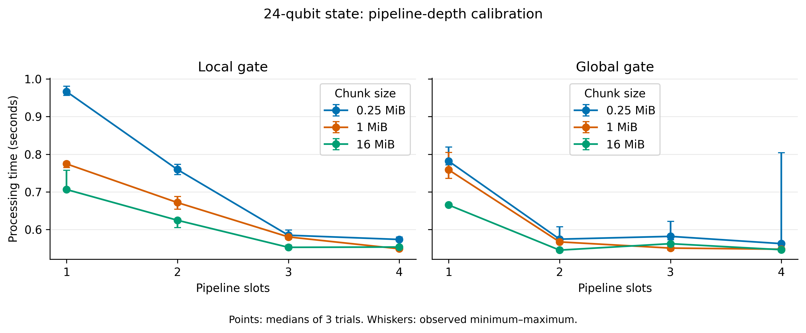
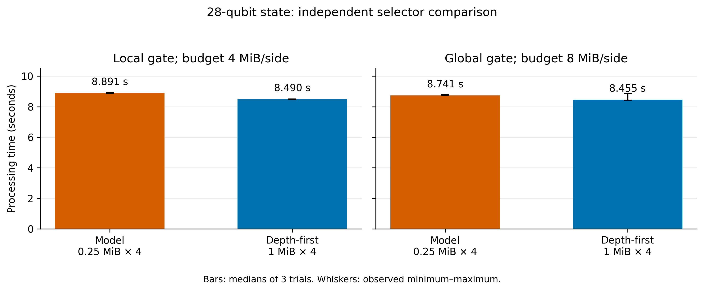

# QuantSim: SSD-Backed GPU Hadamard Processing

## Purpose

QuantSim is a research prototype for applying a Hadamard gate to a
quantum state vector stored on an SSD. It processes the state in chunks
using bounded host and GPU data buffers.

The implementation combines CUDA computation, pinned host memory,
io_uring file operations, direct I/O, and multiple pipeline slots.

The current scope is a single Hadamard gate per invocation. It is not
yet a general quantum-circuit simulator.

## Research question

How do chunk size and pipeline depth affect processing time under
explicit host and GPU data-buffer budgets, and can a calibrated
performance model select configurations more effectively than simple
selection rules?

The experiments evaluate this question on one laptop and one external
SSD. They do not establish a broadly novel simulation architecture or
performance guarantees across hardware.

## Hardware and software

- GPU: NVIDIA GeForce RTX 2050, 4 GiB VRAM.
- System RAM: approximately 11 GiB reported by the operating system.
- Operating system: Ubuntu 22.04.5 LTS.
- Kernel: 6.8.0-138-generic.
- CUDA compiler: CUDA 11.5.
- Host compiler: GCC 11.4.
- liburing: 2.0.
- Benchmark storage: Crucial X6 external USB SSD, exFAT.
- External storage directory:
  `/media/praneeth/Crucial X6/QuantSim-storage`.

The internal NVMe is not the storage device used for the reported
external-SSD performance experiments.

## State representation and processing

Each amplitude is a double-precision complex value occupying 16 bytes.
An n-qubit state therefore requires 16 × 2^n bytes.

For each candidate chunk size:

- A local gate pairs amplitudes within a chunk.
- A global gate pairs amplitudes across two chunks.
- Each pipeline slot owns one chunk buffer for a local gate, or two
  chunk buffers for a global gate, on both the host and GPU.

The processing sequence is:

1. Read a chunk or chunk pair.
2. Transfer the amplitudes to the GPU.
3. Apply the Hadamard kernel.
4. Transfer the results to the host.
5. Write the updated amplitudes.

Multiple slots allow work on different chunks to overlap.

## Memory budgets

Host and device data-buffer budgets are enforced separately.

For either memory side:

    buffer bytes = chunk bytes × slots × buffers per slot

The buffers-per-slot value is one for local gates and two for global
gates.

These budgets cover pipeline data buffers. They exclude CUDA context
memory, other process allocations, and operating-system caches.

## Default configuration selector

The default selector uses a depth-first heuristic:

1. Consider 0.25 MiB and 1 MiB chunks.
2. Determine the gate type separately for each candidate.
3. Choose the largest feasible depth, up to four slots.
4. Break depth ties by choosing the larger chunk.

For smaller states, candidate chunks are capped at the state size.
The slot count is also capped at the number of available jobs.

The selector respects both host and device data-buffer budgets.
It does not claim to find an optimum outside its candidate set.

## Build and run

From the project root:

```bash
bash checks/build_core.sh
```

Inspect a configuration without executing it:

```bash
python3 checks/select_config.py 28 27 8 8
```

Arguments are:

    qubits target host_budget_MiB device_budget_MiB

Run a complete initialization, Hadamard, and validation experiment:

```bash
python3 checks/run_selected.py 20 0 2 2
python3 checks/run_selected.py 20 19 1 1
```

The runner creates a temporary state on the external SSD, initializes it
to the zero basis state, applies one Hadamard gate, validates the output,
and saves a JSON report under the external results directory.

It removes the temporary state afterward. It does not operate on the
project's existing data/state.bin.

The external SSD must be mounted at the configured path.

## Correctness evidence

Completed checks include:

- Local and global gate processing.
- Dense-state comparisons against reference calculations.
- Multiple pipeline depths.
- Direct-I/O execution.
- Buffer-budget rejection and boundary cases.
- End-to-end execution through the automatic selector.
- A 30-qubit, 16 GiB state processed with 8 MiB of host data buffers
  and 8 MiB of device data buffers.

The 16 GiB experiment exceeded both the available physical RAM and GPU
memory. Its maximum amplitude error was approximately 1.11 × 10^-16.

The large-state validation used a single Hadamard applied to the zero
basis state. Dense-state correctness was tested separately at smaller
sizes.

## Performance findings

### Pipelining

In the initial 24-qubit depth pilot using 1 MiB chunks:

| Gate | One slot | Four slots | Speedup |
|---|---:|---:|---:|
| Local | 771.052 ms | 532.628 ms | 1.45× |
| Global | 749.282 ms | 531.854 ms | 1.41× |

The 30-qubit global-gate experiment processed a 16 GiB state in
33.879 seconds, excluding setup.

### Model-based selection

The original performance model did not demonstrate a configuration
selection advantage over the depth-first heuristic.

On the independent 28-qubit comparison, the model-selected configuration
was 4.73% slower for the local case and 3.39% slower for the global case
than depth-first.

Its selected configurations also matched the simpler small-chunk rule
in all eight previously audited budget scenarios.

### Matched storage control

A storage-only control using the GPU application's scheduler showed
that the earlier standalone storage profiler did not reproduce the
same scaling behavior.

At four slots, matched control and GPU processing times were often
close. At lower depths, storage-only measurements could substantially
underestimate GPU pipeline time.

For example, under a 2 MiB-per-side local-gate budget, selecting by
storage-control time chose a configuration that was 17.07% slower on
the GPU than the depth-first choice.

These observations support using the simple heuristic as the default
for the tested setup. They do not establish its universal optimality.

## Timing interpretation

Processing time measures the pipeline loop through completion of its
writes. It excludes setup, state initialization, and validation.

Write completion is not an explicit durable-storage flush guarantee.

Setup time and whole-process wall time are separate quantities.
Single integration-check timings are not benchmark results.

Budget scenarios can reuse the same configuration timing samples;
they should not be treated as independent repeated experiments.

## Limitations

- One GPU and one external USB SSD/filesystem combination.
- Single-Hadamard workload.
- Candidate chunk sizes and pipeline depths are limited.
- Small repetition counts; small timing differences do not establish
  statistical significance.
- Revised models evaluated against already inspected measurements
  require fresh validation before generalization claims.
- Calibration overhead must be included when assessing whether a
  model-based selector provides practical value.
- Existing results do not establish a model-based selection advantage.

## Main conclusion

QuantSim demonstrates correct SSD-backed Hadamard processing with
bounded data buffers and useful pipeline speedups on the tested system.

The experiments also show that configuration selection must account
for the actual GPU scheduler. The evaluated performance model has not
outperformed the simpler depth-first heuristic.

## Figures

### Pipeline-depth calibration



**Figure 1.** GPU processing time for a 24-qubit state (256 MiB)
on the external USB SSD. Points show medians of three trials;
whiskers show the observed minimum and maximum. Setup,
initialization, and validation are excluded.

Increasing pipeline depth generally reduced processing time.
For local gates, the tested chunk sizes approached similar times
at four slots. Global gates obtained much of their improvement
at two slots, with smaller and sometimes non-monotonic changes
afterward. The wide range for one configuration demonstrates
run-to-run variability.

### Independent selector comparison



**Figure 2.** Processing time for a 28-qubit state (4 GiB), comparing
the frozen model's selection with the depth-first heuristic.
Bars show medians of three trials; whiskers show the observed
minimum and maximum. Both methods operated within the indicated
data-buffer budgets.

The model selected 0.25 MiB chunks with four slots; depth-first
selected 1 MiB chunks with four slots. The model's median
processing time was 4.73% higher for the local gate and 3.39%
higher for the global gate.

The model-selected configuration used one quarter of the
pipeline data-buffer memory: 1 versus 4 MiB per side locally,
and 2 versus 8 MiB per side globally. However, the simpler
small-chunk rule selected the same configuration, so this
memory tradeoff does not establish an advantage specific
to the performance model.

## Historical experiment scripts

The earlier scripts `benchmark_depth.py`, `benchmark_chunks.py`, and
`check_large_state.py` regenerate the project's `data/state.bin`.
They should only be rerun when replacing that state is intended.

For the standard demonstration, use `run_selected.py`, which creates
an isolated temporary state. The updated `validate_dense.py` also
uses a temporary directory on the external SSD.